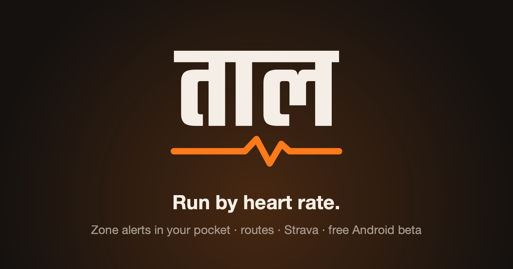

<p align="center"></p>

# Taal (ताल)

A free Android app for heart-rate zone running. Your phone stays in your pocket with the screen off and
**vibrates when you drift out of your zone**: one pattern when you go too hard, another when you drop too low.

**Download the beta:** https://taal.taal-app.workers.dev (Android 12+, not on the Play Store yet)

I vibe coded this with [Claude Code](https://claude.com/claude-code) for my own Zone 2 runs, then kept going.
It's a beta: expect rough edges, and please open an issue when something breaks.

## What it does
- **Live heart rate** from any Bluetooth chest strap or armband, a watch that broadcasts heart rate, or a
  Samsung Galaxy Fit3.
- **Zone alerts in your pocket**: five zones from your age and resting heart rate (Karvonen), above / below /
  back-in-zone vibrations, all with the screen off.
- **GPS runs**: distance, pace, splits, auto-lap, auto-pause, voice cues, live map; gaps in GPS are bridged with
  your steps. Walks, treadmill, cycling and strength too.
- **Routes**: draw a route (tap or freehand, snapped to real paths), let the phone plan a loop of any distance from
  where you stand (OpenStreetMap data, planned on the phone), or import GPX, then follow it with off-route alerts.
- **Workouts and training**: structured workouts, a calendar, race pacer, training load and recovery, VO2max
  and race-time estimates, a suggested workout for today.
- **After each run**: title, note, effort, achievements (fastest 1 km / 5 km / 10 km, longest run) and a share
  image for Instagram / WhatsApp.
- **Optional sync** to Strava and Health Connect (Samsung Health, Google Fit…).

No account, no ads, no analytics. Activities live in a SQLite database on the phone.

## How it's built
Kotlin + Jetpack Compose, two Gradle modules:

```
core/   pure Kotlin, no Android: zones and alert timing, GPS distance and smoothing, laps / auto-pause,
        workouts, pacer, training stats, achievements, GPX/TCX, OSM path graph, loop planner,
        drawn-route matching, Galaxy Fit3 data decoder. Unit-tested (./gradlew :core:test).
app/    Android: BLE heart-rate client, foreground service that runs the session with the screen off,
        SQLite storage, Strava + Health Connect, Compose UI (My Day, Activities, Run, Training, Device).
strava-worker/  Cloudflare Worker that holds the Strava client secret and does the OAuth token exchange.
site/           download page; scripts/release.py builds the signed APK + page + version.json.
```

During a run, `SessionController` ticks every 500 ms: heart rate goes to `ZoneMonitor` (decides when to buzz),
GPS to `RouteTracker` (distance, splits), steps to the cadence tracker; the live state drives the Run screen and
the notification, and is saved every 30 s.

## Build it yourself
Needs JDK 21 and the Android SDK (compileSdk 37).

```bash
./gradlew :core:test :app:assembleDebug
adb install -r app/build/outputs/apk/debug/app-debug.apk
```

Optional settings in `local.properties` (git-ignored):

| Key | For |
|---|---|
| `MAPS_API_KEY` | Google Maps tiles (without it, routes are drawn as a plain line) |
| `STRAVA_CLIENT_ID`, `STRAVA_TOKEN_URL` | Strava upload through your own API app and token Worker |
| `RELEASE_STORE_FILE`, `RELEASE_STORE_PASSWORD`, `RELEASE_KEY_ALIAS`, `RELEASE_KEY_PASSWORD` | signing a release build |

The debug build installs as "Taal dev" (`com.rameez.fit3zone`) next to the release app (`com.rameez.taal`).

## Privacy
Location is used only during GPS activities. Nothing leaves the phone unless you turn on Strava or Health
Connect, share something yourself, or plan a loop (then only the area around you is requested from the public
Overpass API). Full policy: https://taal.taal-app.workers.dev/privacy.html

## Good to know
- Not a medical device; zones and training numbers are estimates.
- Independent project, not affiliated with Samsung, Garmin or Strava. Reading Galaxy Fit3 band data is
  unofficial and experimental, read-only, and off by default.
- Map data © OpenStreetMap contributors (ODbL).

## License
MIT, see [LICENSE](LICENSE). Fonts (Inter, Space Grotesk, Teko) are under the SIL Open Font License 1.1.
